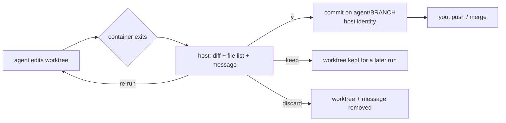

# sandbox-engine

Run a coding agent CLI in an [apptainer](https://apptainer.org) container
on your own checkout. The agent can edit your project's files. It cannot
rewrite git history, read host files you did not mount, or load project
configuration you have not committed. Its work reaches your repository
only through a commit that you approve.

```
./sandbox.sh [options] <claude|omp|opencode> [agent-args...]
```

| agent | CLI | status |
| --- | --- | --- |
| [Claude Code](https://docs.anthropic.com/en/docs/claude-code) | `claude` | supported, best tested |
| [oh my pi](https://omp.sh) | `omp` | supported, best tested |
| [opencode](https://opencode.ai) | `opencode` | supported, less tested |

## The idea

A coding agent is most useful when it can run freely: edit files, run
builds and tests, install packages. It is safest when nothing it does
counts until a human has looked at it. sandbox-engine resolves that
tension by drawing one boundary and enforcing it with the kernel:

> **The agent writes files. A human writes history.**

Five principles follow from it:

1. **Enforce with mounts, not with policy.** Containment comes from
   read-only bind mounts and absent paths. It does not rely on a command
   wrapper, a tool allow-list, or a missing `git` binary, so a
   self-installed git or a library that never execs hits the same
   read-only filesystem. (An earlier allow-list design was retired for
   this reason; see `docs/git-breakout.md`.)
2. **Git history is the trust boundary.** Everything in the working tree
   is considered agent-writable. Everything in `.git` is human-owned.
   Work crosses from one side to the other only through a commit that a
   human makes or approves.
3. **Committing is consenting.** The same rule decides what the host
   trusts. Project config that agents, editors or hooks would load, and
   `sandbox.yml` itself, take effect only when committed and unmodified,
   because that is content you have reviewed. Uncommitted versions are
   hidden or refused, so an agent cannot plant config for its next run
   or for your editor.
4. **Mount nothing by default.** The checkout, the agent's own config,
   and a per-run `/tmp` are mounted. Every other mount is something you
   asked for. It is printed at startup, and outside the project it needs
   confirmation.
5. **Say what is not contained.** The open network, readable history and
   the agent's own credentials are documented limits, not omissions (see
   [Limitations](#limitations)). Every boundary claim in `docs/` is
   either measured, with its reproduction, or marked as derived from
   source.

## Quick start

**Host requirements**

- Linux (on Windows: WSL 2) with `apptainer`, able to run
  `apptainer build --fakeroot`. On Windows, install apptainer inside the
  WSL distribution and run everything from there; WSL works well.
- A `buildctl` or `docker` client on the host. Images are built from
  Dockerfiles through apptainer's `dockerfile:` bootstrap, which needs
  one of them. The BuildKit or Docker daemon that client talks to can run
  on another machine. The setup is in `docs/usage.md`, "Building images on
  another machine".
- `bash`, `git`, `awk`. Optional: `curl` (checks for agent updates),
  `flock` from util-linux (lets concurrent runs share a `.venv` mount
  point), `timeout` (puts a time limit on commit-message generation).

**Run an agent on a project**

```sh
git clone https://github.com/dkuegler/sandbox-engine.git ~/sandbox-engine
cd ~/path/to/project
~/sandbox-engine/sandbox.sh claude        # or: omp, opencode
```

The first run for each agent and environment builds an image into
`~/.apptainer/images` (set `SANDBOX_ENGINE_IMAGE_DIR` to store it
elsewhere). That build takes a few minutes. Later runs start straight from
the image. Startup prints every mount and pauses on any warning until you
confirm it.

Neither the agent nor its login has to exist on the host. Log in from
inside the sandbox on the first run. The login is stored in files bound
from your host `$HOME` (`~/.claude`, `~/.omp`, ...), so later runs
reuse it, and so does the agent on the host, if you install it there.

**Make the sandbox the default**

```sh
# ~/.bashrc or ~/.zshrc
alias omp="$HOME/sandbox-engine/sandbox.sh omp"
alias claude="$HOME/sandbox-engine/sandbox.sh claude"
```

`omp`, `omp --worktree fix-parser` and `claude --resume` now all run
sandboxed. sandbox-engine recognises its own options anywhere on the
command line and passes everything else to the agent. The exceptions are
`-h`/`--help` and `-v`/`-vv`: after the agent name, they go to the agent.
Use `command omp` or `\omp` to reach an agent installed on the host.

**Run in a throwaway worktree, with a commit gate (`--worktree`)**

```sh
~/sandbox-engine/sandbox.sh --worktree fix-parser omp
```

1. **Setup.** The run creates branch `agent/fix-parser` from the main
   checkout's current `HEAD` and a worktree for it in
   `~/.agent/worktrees/<project>-<hash>/fix-parser`. Uncommitted changes in
   the main checkout are not carried over. To start from another branch or
   commit, check it out in the main checkout first. If both the branch and
   the worktree already exist, the run resumes them as they are, whatever
   `HEAD` is now. Any other mix of an existing branch and worktree refuses
   the run. A lock keeps a second run out of the same worktree.
2. **Main checkout.** On the terminal, you choose how your main checkout is
   mounted beside the worktree:
   - `r`: read-only.
   - `w`: read-write.
   - `n`: working tree not mounted. Its untracked and ignored files are out
     of reach, but history stays readable.

   Every `.git` stays read-only in all three cases.
3. **Session.** The agent edits the worktree. It can propose a commit
   message in `$HOME/.sandbox-commit-message`.
4. **Review.** When the container exits, the host shows:
   - a color-coded diff;
   - every path the commit would carry;
   - a commit message: the agent's own, or one generated in a second
     container that has no checkout mounted. `--commit-model MODEL` picks
     the model for that container.
5. **Decision.**
   - `y` commits on `agent/fix-parser` with your git identity, removes the
     worktree, and prints the `git push` command.
   - Rejecting offers to re-run the agent in the same worktree, keep the
     worktree for a later `--worktree fix-parser` run, or discard it.

Nothing is committed without your `y`, and nothing is pushed. `--worktree`
needs a terminal. Details: `docs/worktree-mode.md` and
[the contribution gate](#2-the-contribution-gate).

**Build images on another machine (optional)**

The build daemon does not have to run on this host. Forward its socket
over SSH and point the local client at the forwarded socket:

```sh
ssh -fN -o ExitOnForwardFailure=yes -o StreamLocalBindUnlink=yes \
    -L "$XDG_RUNTIME_DIR/docker.sock:/var/run/docker.sock" build-host
export DOCKER_HOST="unix://$XDG_RUNTIME_DIR/docker.sock"   # BuildKit: BUILDKIT_HOST
~/sandbox-engine/sandbox.sh --rebuild claude
```

Do not use `ssh://` addresses, `docker context`, or a plaintext `tcp://`
BuildKit address. `docs/usage.md`, "Building images on another machine",
explains why and covers the BuildKit variant. The build daemon decides
what the sandbox's root filesystem contains, so trust it as part of the
sandbox.

**Configure the environment (optional)**

```sh
cp ~/sandbox-engine/sandbox.example.yml sandbox.yml   # edit it, then:
git add sandbox.yml && git commit -m "Add sandbox.yml"
```

`sandbox.yml` chooses the base image (presets `uv` (the default),
`python`, `shell`, `latex`, or your own `image:`/`dockerfile:`), adds
extra mounts (`binds:`), and sets the patch directory (`patches:`). The
file is honoured only once it is committed and unmodified. Run
`./sandbox.sh -h` for every option, and see `docs/usage.md` for the full
reference.

## What sandboxing means here

The project addresses two separate concerns.

### 1. Contained execution

The agent runs inside the container with `--containall` and an explicit
`--no-mount home,cwd,tmp,hostfs,bind-paths`, so the host's
`apptainer.conf` defaults cannot add mounts. The session sees only:

| path | access |
| --- | --- |
| the project checkout | read-write |
| every `.git` in it (including nested repos, submodules and worktree gitdirs) | read-only, kernel-enforced; remote URLs and credentials redacted |
| project config that agents, editors or hooks load (`config/mask.toml`) | a read-only copy of `HEAD` if committed and clean, hidden otherwise |
| the agent's global config in `$HOME` | read-only; writable state is bound path by path, with a per-run `~/.omp` (omp) or `$HOME` (claude) |
| `.env` files | never mounted |
| host virtualenvs (`.venv`, ...) | replaced by an empty per-run directory |
| `/tmp` | a per-run host directory, removed at exit |
| `/` | the image, read-only |
| anything else on the host | absent unless you `--bind` it; binds outside the project need confirmation |

Inside the session, the agent can read the same summary at
`$HOME/.sandbox-limitations.md`.

### 2. The contribution gate

Nothing the agent does lands in your history without your approval.

**Gate 1: the commit.** Every gitdir is read-only, so `commit`, `add`,
`checkout`, `rebase`, `gc` and the like fail with `Read-only file system`,
whichever git binary the agent runs. Only a human on the host can commit:

- *Default mode:* the agent edits your working tree directly. You review
  the result with your own tools (`git diff`) and commit it yourself.
- *`--worktree BRANCH`:* when the container exits, the host shows a
  color-coded diff, every path the commit would carry, and a commit
  message. The agent may write that message to
  `$HOME/.sandbox-commit-message`; otherwise a second container with no
  checkout mounted generates one. The commit runs on the host, with your
  git identity, only after you answer `y` on the terminal. No flag,
  environment variable or unattended path skips this prompt.

**Gate 2: `agent/*` branches.** An approved worktree commit lands only on
`agent/BRANCH`, never on a branch you work on. A collision is never
guessed at: an existing worktree together with its branch is resumed, and
any other combination refuses the run. Nothing is pushed. The run prints
the `git push` command, and merging `agent/BRANCH` into your own branches
is up to you.



## Limitations

These are deliberate scope boundaries, not bugs. Choose what you mount
with them in mind.

- **The network is unrestricted.** Raw outbound TCP works, and an
  unprivileged apptainer has no way to restrict it without root. Anything
  the agent can read, it can send somewhere.
  - An egress proxy is not excluded by design but by lack request, the
    inference provider must be accessible, documentation on the internet
    is a significant lever.
- **The agent's own model credentials are inside the sandbox.** Claude's
  `~/.claude/.credentials.json` and omp's `agent.db` are bound so the
  agent can log in. Together with the open network, the agent can
  exfiltrate them.
- **Repository confidentiality is not protected.** `.git` is read-only,
  not hidden: every committed version of every branch is readable. In
  `--worktree` mode, choosing `n` (main checkout not mounted) hides
  untracked and ignored files but not history.
- **`git push` is not blocked, only disarmed.** A push writes to the
  remote, not to `.git`, so the read-only mask does not stop it: it
  succeeds and only the local `refs/remotes/*` update fails
  (`docs/git-breakout.md`). What stops a push to your real remote is
  that the agent has neither its address nor a credential for it:
  - every `.git` file git reads for remotes (`config`, `config.worktree`,
    `FETCH_HEAD`, `logs/HEAD`) is overlaid with a read-only sanitized
    copy (`functions/git-mask.sh`). `url`/`pushurl` become
    `REDACTED-BY-SANDBOX`, and `[credential]`, `[http …]`, `[url …]` and
    `[include…]` sections are dropped, so `git remote -v` shows a
    placeholder while `git log origin/master` still works;
  - no forge credential is mounted: `$HOME` is not bound, so there is no
    `~/.ssh`, `~/.gitconfig`, `~/.git-credentials` or `~/.config/gh`, and
    `--containall` starts from a clean environment, so `SSH_AUTH_SOCK`
    and forge tokens are not inherited.

  The push still lands if the agent is given a URL that needs no
  credential (anonymously writable, or token in the URL), if a credential
  reaches it some other way (a forwarded environment variable, a
  `--bind`), or if the remote is a local path inside a bound tree. The
  gate protects your local repository, not remote services.
- **The default mode writes into your working tree.** Uncommitted work in
  the checkout can be changed or deleted by the agent. Use `--worktree`
  when that matters.
- **Shared folders are shared.** These host directories are bound
  read-write into every run of every project, so one session can plant
  content a later session, in any project, consumes:
  - `~/.agent/uv-cache`: uv's package cache (`/tmp/.cache/uv` in the
    session). A poisoned wheel installs in later sessions.
  - `~/.agent/omp-models` and `~/.agent/omp-embeddings`: omp's on-device
    model and embedding weights. The code that loads them stays per run.

  Per project, and shared by both modes and every worktree of that
  repository: `~/.agent/omp-history/<key>`, `~/.agent/omp-logs/<key>` and
  `~/.agent/opencode-share/<key>`.
- **`--worktree` is interactive only.** The approval prompt needs a
  terminal.
- **Agent installs are not pinned.** Every image build installs the
  agent's current upstream release. When an agent changes the config paths
  it reads, the masks must be re-checked (`docs/maintenance.md`).
- **Not verified for every layout.** Masking of submodules, nested repos
  and worktree gitdirs is implemented and checked host-side. Only a
  top-level `.git` has been observed read-only inside a live container
  (`docs/git-breakout.md`, "Untested").
- **Linux (including WSL 2) and apptainer only.** The runtime-specific
  code lives in `functions/apptainer.sh`; there is no docker or microVM
  backend. apptainer has no gVisor launch path.
- **opencode:** its server mode does not work under `--containall`
  (`docs/parallelization.md`).

## Project structure

```
sandbox.sh                 entry point: argument parsing, then the run in order
sandbox.example.yml        annotated sample sandbox.yml
config/mask.toml           project config paths to mask, per agent and tool
functions/
  apptainer.sh             the backend: build, launch line, containment flags
  argv.sh                  option parsing
  project-sandbox-config.sh  sandbox.yml parsing and its committed-and-clean gate
  environment.sh           base image selection, image build, agent update check
  binds.sh                 extra binds, project config masks, $HOME config binds
  git-mask.sh              read-only .git masks, credential/URL redaction
  python-env.sh            per-run virtualenv masks, shared uv cache
  agents.sh                per-agent configuration and instruction-file overlay
  claude-home.sh           claude's per-run $HOME
  claude-json.sh           ~/.claude.json key scanner and merge-back
  omp-home.sh              omp's per-run ~/.omp and config merge-back
  worktree.sh              --worktree: create/resume, lock, review, commit
  commit-message.sh        isolated commit-message generator
  run-dir.sh, cleanup.sh   per-run scratch directory and exit hooks
  log.sh                   logging
sandbox/
  agent/Dockerfile.template  agent image layered on the chosen base
  uv/ shell/ latex/          preset base images
tests/
  git-escape/              git write containment (host-side + live container)
  config-escape/           config surface and host-state leakage (host-side)
  tool-failure/omp.py      failed-tool-call ratios from omp session logs
docs/                      user reference and fact records (docs/README.md)
```

## Documentation

- `docs/usage.md`: the full user reference, covering options,
  `sandbox.yml`, what the session sees, worktree mode, and the host state
  a run leaves behind.
- `docs/README.md`: the index of fact records. Each one is a dated,
  reproducible record of a boundary: `.git` masking, config masking,
  apptainer behaviour, worktree mode, and more.
- `docs/tests.md`: how to run the test suites.

## Testing

```sh
./tests/git-escape/worktree_check.sh      # host only
./tests/git-escape/sanitize_check.sh      # host only
./tests/config-escape/mask_check.sh       # host only
./tests/git-escape/run.sh                 # needs apptainer
./tests/git-escape/run.sh --negative      # meta-test: must FAIL
```

See `docs/tests.md` for the complete check list, including
`bash -n` and `shellcheck`.

## Removing it

Delete the checkout, then the host state it leaves behind: images in
`~/.apptainer/images` (`sandbox-engine` names them
`<agent>.<env-tag>.sif`) and `~/.agent/` (worktrees, shared caches,
per-project omp and opencode state). `docs/usage.md`, "Host state outside
the checkout", lists each path.
